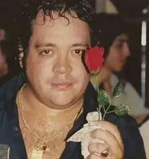

# 🍷 ¿Querés tomar un vinito y charlar conmigo? ❤️

Una web interactiva estilo **8-bits retro arcade** con la pasión de **Leo Mattioli** para invitar a alguien a una cita romántica inolvidable.



---

## 🕹️ Características

- 🎮 **Estética 8-Bits:** Tipografía pixel art (`Press Start 2P`, `VT323`), marcos de diálogo estilo RPG retro, corazones flotantes y efecto scanlines CRT.
- 💨 **Botón "NO" escurridizo:** Esquiva el cursor del mouse automáticamente por proximidad y se escapa de los toques en celulares mostrando frases cómicas. ¡Solo es posible decir que **SÍ**!
- 🦁 **Aparición de Leo Mattioli:** Al presionar "SÍ", suena una fanfarria y aparece el León Santafesino con su icónica rosa roja para dar su bendición a la cita.
- 📅 **Coordenadas del Encuentro:** Selector de fecha, hora y lugar (con sugerencias rápidas de bodegón, bar o placita).
- 🔥 **Cierre triunfal "¡AY AMOR!":** Animación y jingle romántico de cumbia 8-bits.
- 📲 **Envío por WhatsApp:** Abre automáticamente la conversación de WhatsApp con el mensaje formateado con todos los detalles de la cita.

---

## 🚀 Probar Localmente

Basta con clonar el repositorio y abrir `index.html` en cualquier navegador:

```bash
git clone https://github.com/carenchushine/cita-leo-mattioli.git
cd cita-leo-mattioli
# Abrir index.html
```

---

> *"Si te vas... ¡no te vayas nada!"* — **Leo Mattioli 🌹**
